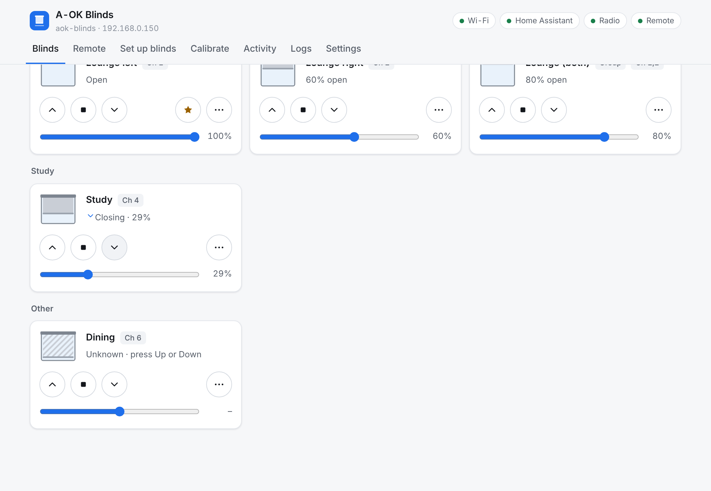

# A-OK Blind Bridge

[](https://github.com/olliemaller/aok-blind-bridge/actions/workflows/ci.yml)
[](https://github.com/olliemaller/aok-blind-bridge/releases/latest)
[](LICENSE)

Local control of **433.92 MHz A-OK blind motors** from Home Assistant, using an ESP32 and a CC1101 radio module (about A$15 of parts). Motorised blinds sold as **Motolux**, and under other brands, use these motors with remotes such as the AC127. No cloud, no Tuya hub and no app.

**[Install it from your browser →](https://olliemaller.github.io/aok-blind-bridge/)**

<p align="center"></p>

## What it does

- **Learns your remote.** Press Up, Down and Stop once. The bridge copies the remote, so the motors accept it like a second remote. Nothing on the motors changes, and nothing needs re-pairing.
- **Follows the hand remote.** When someone uses the remote on the wall, the bridge hears it, and the positions in Home Assistant move to match.
- **Positions, not just up and down.** Each blind gets a 0–100 % slider. The bridge times the travel and sends Stop at the right moment. Opening and closing have separate travel times.
- **Groups and all-blinds.** A blind on several channels moves them together in one radio frame. One button moves every blind.
- **Shows up in Home Assistant on its own** through MQTT discovery. You get a cover per blind, put in the room you set, plus a remote-button event entity for automations.
- **Runs from its own web page:**
  - setup Wi-Fi portal
  - remote learning
  - blind set-up with test buttons
  - travel-time calibration with a log
  - a live view of what the radio hears
  - an event log
  - settings backup and restore
  - firmware updates
- **Or use ESPHome.** The [`aok_rf` component](docs/esphome.md) gives you the radio as an ESPHome component instead.

## Hardware

| Part | Notes |
|---|---|
| ESP32 dev board | Classic ESP32, such as the HW-395 / ESP32-WROOM-32 DevKit (38 pins). |
| CC1101 module, 433 MHz | The common blue 8-pin board ("CC1101 433M V2.0") with its spring or wire antenna. |
| 8 jumper wires | Female–female. |

Power the CC1101 from **3V3, never 5V**.

| CC1101 pin | ESP32 |
|---|---|
| 1 GND | GND |
| 2 VCC | 3V3 |
| 3 GDO0 (transmit) | GPIO 12 |
| 4 CSN | GPIO 5 |
| 5 SCK | GPIO 18 |
| 6 MOSI | GPIO 23 |
| 7 MISO | GPIO 19 |
| 8 GDO2 (receive) | GPIO 27 |

GPIO 12 is an ESP32 boot-strap pin. If the board won't start with the radio connected, move GDO0 to GPIO 4 and change it under *Settings → Radio*.

## Install

1. Open **[the web installer](https://olliemaller.github.io/aok-blind-bridge/)** in Chrome or Edge.
2. Plug in the ESP32 and press **Install**. Enter your Wi-Fi when it asks.

To flash by hand, download `aok-blind-bridge-<version>-factory.bin` from [Releases](https://github.com/olliemaller/aok-blind-bridge/releases/latest). Write it at address `0x0` with [esptool-js](https://espressif.github.io/esptool-js/) or `esptool.py write_flash 0x0 …`. If the board has no Wi-Fi set, it opens a setup network called **AOK-Blinds-xxxx**.

## Set up

1. Open `http://aok-blinds.local`, or the IP address your router gave it.
2. **Remote**: press *Start learning*, then press **Up**, **Down** and **Stop** on any channel of your remote.
3. **Set up blinds**: add a blind for each remote channel. The page offers to add the channels your remote has used. Give each blind a room.
4. **Calibrate**: time each blind closing and opening.
5. **Settings → Home Assistant**: enter your MQTT broker. If you don't have one, install the Mosquitto add-on. The blinds then appear under *Settings → Devices & services → MQTT*.

More detail is in [docs/setup.md](docs/setup.md). Entities and MQTT topics are in [docs/home-assistant.md](docs/home-assistant.md).

## Updating

Go to *Settings → Firmware → Check for updates*. The page downloads the new version from GitHub and installs it. The bridge itself never needs internet access. You can also upload the `…-ota.bin` from a release. Your blinds, remote and settings are kept.

## How the protocol works

[docs/protocol.md](docs/protocol.md) covers the frame layout, timings and channel encoding. It also explains the checksum that lets one press of each button address every channel. If you have a remote that behaves differently, please open an issue with the frames from the *Activity* tab.

## Tested with

- Motolux roller blinds with an AC127-06L 6-channel remote. Learning, up, down, stop, positions and calibration all work.
- Not yet tested on real motors: the *All blinds* button (one frame with many channels), and remotes other than the AC127.

## Limits

- The motors don't report their position. Positions are estimated from travel time. If a blind is moved some other way, use *Mark as open/closed*.
- Only A-OK's 64-bit remotes are supported. Older formats show in the Activity tab but can't be sent.

## Development

```bash
pio run -e hw395                       # build (ui/index.html is gzipped into the firmware automatically)
tools/package.sh . dist                # factory + OTA images
g++ -std=c++17 -I include test/test_protocol.cpp -o /tmp/t && /tmp/t   # protocol round-trip tests
python3 tools/mock_bridge.py           # fake bridge API at http://localhost:8099 for working on the page
```

| Path | What's there |
|---|---|
| `src/main.cpp` | Firmware: radio, position model, MQTT, web API, Improv |
| `include/aok_protocol.h` | Protocol encode/decode, header-only and host-testable |
| `ui/index.html` | The web dashboard |
| `esphome/` | ESPHome component and example |
| `site/` | Web installer (deployed to GitHub Pages by the release workflow) |

Releases are automatic. Bump `FW_VERSION` in `src/main.cpp`, add a section to [CHANGELOG.md](CHANGELOG.md), and push to `main`. See [CONTRIBUTING.md](CONTRIBUTING.md).

## Credits

- The A-OK frame format and checksum rules were first worked out by **pgnehm** in [ESP32-Orvibo-A-OK-HomeAssistant-Blind-Bridge](https://github.com/pgnehm/ESP32-Orvibo-A-OK-HomeAssistant-Blind-Bridge). This project is a separate implementation built on that research.
- CC1101 driver: [SmartRC-CC1101-Driver-Lib](https://github.com/LSatan/SmartRC-CC1101-Driver-Lib) by Little Satan (MIT).
- Web installer: [ESP Web Tools](https://esphome.github.io/esp-web-tools/).

## Licence

[MIT](LICENSE) © 2026 Oliver Maller
